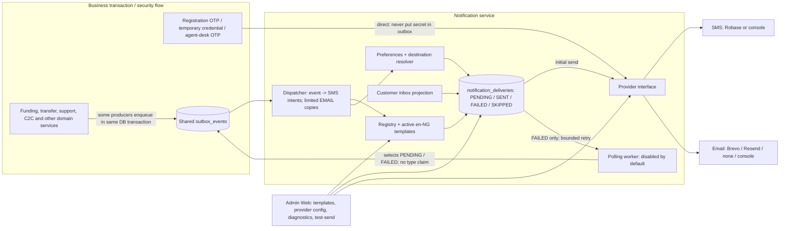
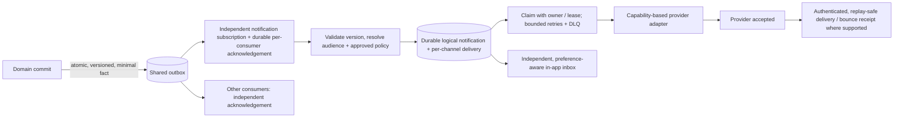

# Arena 1 — Notification architecture and extensibility audit

**Date:** 2026-10-28

**Disposition:** **NO-GO for production SMS/email notification activation**

**Scope:** Read-only assessment; this document is not implementation or permission to activate a provider.

**Application source reviewed:** `fe06ea8f7f6345db1542a17995c1d17b2aa07631`

**Integration documentation baseline:** `08b8329e6f0f8f2e81ee8702ad2855d17f1d3852`

**Independent acceptance incorporated:** `cfc0dc9901fe66e80ed1d307fdfa6a80370c34b8`; local documentation merge `438afa13ad05663d946d40710370f0c3ecc30ff3`. The non-documentation diff between the reviewed application SHA and that merge is empty.

> This is an evidence snapshot of that SHA, not a claim about subsequent fixes or production configuration. A registered template, an event name, a passing mock, a provider's acceptance of a request, and a message received by the intended person are five different things.

## 1. Executive assessment

MonieNaija has a meaningful notification foundation: a shared outbox, provider-neutral interfaces, Robase/Brevo/Resend adapters, delivery rows, bounded retries for some failures, a governed SMS/email template registry, and a substantial Admin Web surface. There are also security-conscious controls: direct handling of OTP-class messages without persisting their secrets in the notification outbox, template-variable restrictions, safe HTML rendering, pinned provider egress, encrypted managed provider credentials, maker-checker controls, and C2C beneficiary-message minimization.

Those controls do **not** yet establish reliable end-to-end coverage. Most importantly:

1. The notification poller selects **all** pending/failed shared-outbox events, does not claim them, and marks even unknown/zero-intent events `PUBLISHED`. It can also publish after an insertion failure was swallowed. This risks lost notifications and interference with other consumers. (§4.1; **P0-2**)
2. For the authenticated customer transfer path, actual completion/failure producers omit recipient IDs expected by the mapper; an offline producer-shaped probe yielded **zero intents**. Deposit/withdrawal events are also not mapped. (§3; **P0-4**, **P1-2**)
3. The canonical Nigerian phone is a 10-digit national significant number, but Robase merely prefixes `+`; a fake-transport probe showed `8012345678` becomes `+8012345678`, not `+2348012345678`. Vendor outcome was not tested. (§6; **P0-5**)
4. A crash or status-update failure can leave a delivery `PENDING`; the retry worker selects only `FAILED`. Claimed retry rows have no explicit owner/renewable lease, and generic exceptions can leave attempts unchanged. Provider acceptance is not receipt. (§4.2; **P0-3**)
5. Successful provider identifiers can disclose untrusted data, and omitted SPF/DKIM/DMARC booleans violate the stated acceptance criterion. Arena 4 independently found **F-01 and F-05 open**; Arena 2 owns those remediations. Do not duplicate or interfere. [Independent acceptance](audit/20261028/sprint1-security-acceptance/11-FRESH-INDEPENDENT-ACCEPTANCE-fe06ea8f-20261028.md).
6. Customer contact selection orders verified contacts but does not require verification; preference lookup errors are ignored. Ordinary delivery payloads use a generic secret-key denylist rather than a financial-data allowlist, so internal IDs and free-text reasons can remain in delivery storage. The console adapter logs full destinations and messages, including direct security messages, in environments where it is allowed. (§5; **P0-6**, **P1-1**)
7. Templates and provider settings have real governance, but retries can use a different active email template and truncated persisted text. There is no verified end-to-end delivered/bounced receipt, notification-specific retention policy, owned DLQ, comprehensive alerts, or real-provider readiness evidence. (§4–7; **P1-3**, **P1-5**, **P1-6**)
8. Admin has nine useful sections, but navigation and backend registry permission predicates are not identical; manual retry is deliberately deferred in the approved V1 read-only scope. Push/device tokens and agent delivery identities are dependencies, not live features. (§7)

**Release position:** keep activation dark. Fix the reviewed security blockers, materialization/consumer isolation, recovery, producer contracts, phone normalization and privacy gates for every event/channel in launch scope; then run independently reviewed real-PostgreSQL, controlled staging and operational acceptance. The fixes must not change the accounting, settlement, compliance or C2C expiry policies to make notifications pass. No automatic release, refund, redistribution or other expired-C2C disposition is authorized here.

### 1.1 Status labels — evidence, not percentages

| Surface | Status | Evidence and qualification |
|---|---|---|
| Core delivery/outbox | **BLOCKED** | Provider interface and delivery table exist; shared-outbox acknowledgement and `PENDING` recovery are not reliable enough for launch. |
| SMS | **BLOCKED** | Direct security sends and Robase adapter exist; national-to-E.164 defect, privacy and reliability gaps remain. No real delivery was tested. |
| Email | **BLOCKED / DARK BY DEFAULT** | Brevo/Resend adapters and templates exist, but provider defaults to `none`, email events default off, coverage and retry fidelity are incomplete, and sender/DNS/live receipt are unverified. |
| Templates | **PARTIAL / GOVERNED** | Versioned SMS/email registry, approval and safe rendering are implemented for a fixed code-defined catalogue; no general dynamic onboarding or multilingual runtime. |
| Business-event coverage | **INCOMPLETE** | Funding/support have producers and mappings; important transfer payloads mismatch; deposit/withdrawal and several real domains lack mapped notification producers. |
| Admin Web | **PARTIAL** | Nine sections, governance, diagnostics and controlled test send exist; permissions, operational capabilities and real-world UAT remain to be aligned. |
| Security/privacy | **NO-GO** | F-01/F-05 remain open on reviewed SHA; console direct-message logging, verified-contact enforcement, payload minimization and privacy/consent policy require work. Some independent controls passed narrow tests. |
| Operations | **NOT READY** | Worker is off by default; no demonstrated production metrics, alerting, key custody, delivery receipts, runbooks or live provider readiness. |
| Extensibility / push | **PARTIAL / NOT WIRED** | Abstractions and some versioned domain envelopes exist, but adding a product requires code changes across producers, mapping, registry and policy. No push-token delivery path was established. |

Status vocabulary used below: **implemented** means code was observed, not that an end-to-end message was received; **partial** means only specified parts exist; **mapped only** means a mapper/template exists without an observed corresponding producer; **not wired** means no notification path was found in the inspected feature; **prospective** is a design recommendation, not a claim that a product exists; **unverified** denotes an external/runtime fact not exercised here. Priorities below describe notification work and release gates, not a legal or business classification.

## 2. Current and target architecture

### 2.1 Observed architecture at `fe06ea8`



This diagram shows code paths, not deployment state or successful delivery. The initial provider call follows delivery-row insertion and occurs inside dispatcher processing, not in a separate durable `PENDING`-delivery worker. `SENT` records adapter success: for a real provider it means API acceptance, while the console adapter can simulate success without sending. `PUBLISHED` is the shared outbox status, not proof that an intended notification was created or delivered.

### 2.2 Recommended destination — proposal only



The notification consumer must not mutate another subscriber's acknowledgement. Materialization of all intended channel rows and its own acknowledgement should be one transaction; external I/O happens **after** that transaction. Provider unavailability must not roll back an already committed journal or cause a second financial transaction. Where a domain fact is mandatory, domain state and its outbox fact must commit or roll back together; this is an atomicity requirement, not permission to make ledger changes or invent financial outcomes. Security challenges remain on a separately reviewed short-lived secret-handling path: no OTP, password, PIN or recovery secret in the general outbox, delivery payload, logs or audit.

## 3. Verified feature-to-notification matrix

### 3.1 Reading the matrix

- **Actual** identifies an inspected domain transition or service; it does not assert that a UI is live or a message was delivered.
- **Current mechanism** distinguishes direct security SMS (`DIRECT`), a producer plus mapping (`OUTBOX→MAP`), a catalogue/template without a producer (`MAPPED ONLY`), and no mapped path observed (`NOT WIRED`). Ordinary mapped events are seeded with SMS enabled and email disabled; a database configuration, a running worker, an available verified destination and provider are still required. SMS/email templates exist for the 20 ordinary catalogue entries; the three security entries are locked and have no editable template. EMAIL copies are appended only for customer funding, transfer and support events when an email provider is configured, then subject to event enablement. [Defaults](../src/notification/notification-defaults-v1.ts), [event map](../src/notification/notification-event-map.ts), [dispatcher](../src/notification/notification-dispatcher.service.ts).
- **Recommended channels** are proposals, not current policy. `S` = SMS, `E` = email, `I` = in-app, `P` = eventual push; `Ops` = restricted workforce queue/console rather than customer messaging. Mandatory/optional and fallback decisions require product, security and legal approval. Existing direct OTP content must never enter generic delivery storage.
- **Priority / sensitivity**: `P0` or `P1` is a suggested product/notification priority; `H` = high sensitivity/security or financial context, `M` = moderate. A row can be P0 for an enabled launch feature even if the product owner elects not to enable it in the first rollout.

| Actual feature / trigger and intended recipient | Current mechanism, registration and delivery | Recommended channels; priority / sensitivity | Gap / qualification |
|---|---|---|---|
| Registration phone-verification challenge → submitted phone | **DIRECT SMS** via registration service; locked `customer.registration.phone_verification`; no editable template or outbox secret. [Service](../src/customer-registration/customer-registration.service.ts) | S; P0/H | Real delivery, E.164 correctness, safe logs and expiration/failure handling must be tested. Do not log the OTP. |
| Workforce issues/reissues a temporary customer credential → customer's verified phone | **DIRECT SMS**; locked `customer.credentials.temporary_credential`; [controller](../src/admin/admin-customer-credentials.controller.ts). | Security-owned short-lived setup flow, S only if approved; P0/H | Existing flow sends a temporary credential; do not expand it or put it into templates/outbox. Security should review whether a safer activation mechanism replaces it; logs must never contain the credential. |
| Agent-desk transaction challenge → customer, not agent | **DIRECT SMS**; locked `agent.desk.customer_otp`. [Service](../src/agent/agent-desk-otp.service.ts) | S; P0/H | Preserve customer ownership, verification and no secret persistence; no implied agent authorization or physical-handover confirmation. |
| Registration/profile creation or successful verification → customer welcome | Registration/profile flows exist; no ordinary welcome notification producer observed. | I; optional E; P2/M | **NOT WIRED.** Do not conflate a verification challenge with onboarding success or infer consent. |
| Login, failed login, new trusted device/MFA change → account owner | Authentication, security history and trusted-device operations exist; no corresponding ordinary notification mapping observed. [Authentication](../src/customer-authentication/customer-authentication.service.ts) | I + security-approved S/E for material changes; P1/H | **NOT WIRED.** Risk thresholds, enumeration protection and device/location accuracy need approval. Do not send secrets. |
| Password change/reset completion and session revocation → account owner | Password rotation/reset/security-history flows exist; no generic customer alert found. [Runtime](../src/customer-authentication/customer-authentication-runtime.service.ts), [customer endpoint](../src/customer-app/customer-app.controller.ts) | I + security-approved S/E; P1/H | **NOT WIRED.** Alert on confirmed state change, not on unauthenticated account discovery; no password, token or reset secret in alert. |
| Onboarding/KYC assessment, proof-of-address upload/review → customer | Customer KYC/onboarding and proof-of-address services exist; notification producer not observed. [Customer](../src/customer/customer.service.ts), [onboarding](../src/customer-onboarding/customer-onboarding.service.ts), [proof of address](../src/customer-proof-of-address/customer-proof-of-address.service.ts) | I/E, S for action required if approved; P1/H | **NOT WIRED.** Report only an authoritative decision; unreviewed documents are not verified identity. No document, ID number, evidence or reviewer-only reason in messages. |
| Funding request created → customer | **OUTBOX→MAP**, `customer.funding.requested`; ordinary SMS template; EMAIL copy possible when configured/enabled. [Producer](../src/customer-funding/customer-funding.service.ts) | I/S or E per approved preference; P1/M | Actual producer emits customer/amount/reference; worker/provider and privacy controls still required. |
| Funding approval/rejection → customer | **OUTBOX→MAP**, `customer.funding.approved` / `.rejected`; ordinary SMS and eligible EMAIL. | I + S/E per approved transactional policy; P0/H | Financial result is authoritative; avoid internal journal ID and rejection free text in delivery storage; no provider call may affect the journal. |
| Generic deposit completed/failed → wallet owner | **OUTBOX PRODUCER**, `deposit.completed` / `.failed`; no notification mapping/default template found. [Deposit](../src/deposit/deposit.service.ts) | I + approved S/E; P0/H | Synthetic completion payload produced zero intents. Resolve rightful owner from authoritative state and contract both outcomes before enablement. |
| Generic withdrawal completed/failed → wallet owner | **OUTBOX PRODUCER**, `withdrawal.completed` / `.failed`; not in notification map/defaults. [Withdrawal](../src/withdrawal/withdrawal.service.ts) | I + approved S/E; P0/H | **NOT MAPPED.** Do not infer settlement or completed physical cash handover from a notification. |
| Agent cash-in/cash-out execution → customer; agent only where authorized | Financial execution and audit exist; no corresponding notification producer found in cash-in/out services. [Cash-in](../src/agent/agent-cash-in.service.ts), [cash-out](../src/agent/agent-cash-out.service.ts) | I + approved S/E for committed result; P0/H | **NOT WIRED.** Preserve CUSTOMER_WALLET and AGENT_CASH invariants; do not create a second posting, imply handover or send PIN/agent secrets. |
| Wallet creation, balance or account-state change → owner | Wallet creation/balance services exist; no specific general wallet notification producer found. [Wallet](../src/wallet/wallet.service.ts) | I for meaningful confirmed changes; S/E only by approved policy; P2/H | **NOT WIRED.** Never derive financial results from stale/cached balance or a provider response. |
| Customer wallet transfer completed → source and destination customers | `transfer.completed` is **OUTBOX→MAP**, but `TransferService` publishes only transfer/journal/payment reference; mapper requires `sourceCustomerId` / `destinationCustomerId`. The separate lifecycle producer emits IDs and can map both. [Actual producer](../src/transfer/transfer.service.ts), [lifecycle producer](../src/transfer/transfer-lifecycle.service.ts), [contract](../src/transfer/transfer-events.ts) | I + approved S/E to each rightful party; P0/H | Real `TransferService` payload yielded **0 intents** in a fake probe; lifecycle-shaped payload yielded two. Same event name currently has incompatible shapes. No live delivery claim. |
| Customer transfer failed/unknown → source customer | `transfer.failed` producer emits transfer ID and failure code, while map expects source/customer ID. `transfer.unknown` is mapped in code but no producer was found; no matching ordinary registry default. | I + approved S/E, with honest outcome; P0/H | Actual failed payload yielded **0 intents**; unknown must not be described as failed or settled without an approved state contract. |
| C2C created → beneficiary phone, possibly not registered | **OUTBOX→MAP** `cash_to_cash.created`, direct PHONE recipient; safe variable subset and locked-down beneficiary copy. [Producer](../src/agent/agent-cash-to-cash.service.ts), [template safety](../src/notification/notification-template.service.ts) | S; P0/H | E.164 defect blocks reliable SMS. Preserve no transfer number, sender phone or secret transfer code in beneficiary message; never invent redemption/fee policy. |
| C2C claimed → relevant claimant/sender/agent | Claim service records authoritative claim; template and map accept claim-shaped payloads, but no `cash_to_cash.claimed` producer was observed. [Claim](../src/agent/agent-cash-to-cash-claim.service.ts) | I/S for authorized parties after product decision; P1/H | **MAPPED ONLY.** Specify audiences and safe semantics; do not infer a physical handover. Agent recipient resolution is missing. |
| C2C expired → authorized parties | Expiry behavior exists; `cash_to_cash.expired` template/map but no matching producer found. [Expiry](../src/agent/agent-cash-to-cash-expiry.service.ts) | I/S only if approved; P1/H | **MAPPED ONLY.** A factual expiry notice cannot authorize refund, release, redistribution, new fees or other disposition. Product must decide separately. |
| Beneficiary added, changed, verified or removed → owning customer | Beneficiary domain and audit/history exist; no notification producer/mapping observed. [Service](../src/customer-beneficiary/customer-beneficiary.service.ts) | I + security-approved S/E on material changes; P1/H | **NOT WIRED.** Never expose beneficiary transfer credentials, PINs or full account details; distinguish authorized verification from a submitted record. |
| Journal reversal / correction → affected customer, as approved | Governed maker-checker reversal and ledger primitive exist; no customer notification mapping observed. [Governance](../src/ledger/ledger-reversal-governance.service.ts) | I + S/E after final authoritative result; P1/H | **NOT WIRED.** Product/finance must define audience, wording and state; do not change the reversal, journal or settlement policy. |
| Limit reached/changed, risk decisions → affected customer / authorized operations | Limit and risk-profile domains exist; no notification mapping found for these decisions. [Limits](../src/limit), [risk](../src/customer-risk-profile) | I or restricted Ops; S/E for approved actionable cases; P1/H | **NOT WIRED.** Do not leak risk thresholds, model signals, privileged investigation or create new grants. |
| Compliance case, assignment, evidence, fraud/escalation → restricted case worker | Case, history and evidence services exist; no notification producer found in the inspected service. [Compliance](../src/customer-compliance/customer-compliance.service.ts) | Restricted Ops queue, optionally generic alert; P1/H | **NOT WIRED.** Existing category-scoped authorization is conditional; unresolved D-01/D-04 and cross-category case-number collision remain. No case details to generic audit or unauthorized workforce; do not equate SERVICE approval with human review. |
| Agent application approved/rejected; agent activated/suspended/reactivated/terminated → agent | Ordinary templates/map exist, while inspected application/lifecycle services write audits but no matching outbox producers. Resolver returns `AGENT_PHONE_DEPENDENCY_MISSING` / `AGENT_EMAIL_DEPENDENCY_MISSING`. [Lifecycle](../src/agent/agent-lifecycle.service.ts), [application](../src/agent/agent-application.service.ts), [resolver](../src/notification/notification-channel-resolver.service.ts) | Verified agent channel + restricted Ops; P2/H | **MAPPED ONLY / DESTINATION BLOCKED.** Do not use application-contact email as a verified delivery identity by assumption. |
| Support ticket created → linked customer and, if applicable, agent | **OUTBOX→MAP**; customer SMS, optional eligible EMAIL; agent intent cannot resolve a delivery contact. [Producer](../src/support/support.service.ts) | I/E, optional S; P1/M | Producer carries customer/agent IDs; successful channel resolution and correct audience still required. |
| Support assignment/status/resolved/closed → ticket owner | **OUTBOX→MAP**, with ticket lookup fallback when IDs omitted; approved SMS/EMAIL template versions. | I/E, S if action required; P1/M | Real producer uses `to`, but the variable resolver expects `status` / `newStatus`; support reference may be absent. Synthetic `IN_PROGRESS` render fell back to “your request” / “updated”. |
| Public support message / dispute update → ticket owner | **OUTBOX→MAP** only for non-internal messages; body is not placed in the event. Internal messages are excluded. | I/E with generic “check account”; P1/H | Preserve internal-note exclusion, scoped support access and no message body/evidence in external delivery. Dispute-specific messaging not proven. |
| Admin approvals and provider/template changes → authorized checker / operations | Approval workflow, audit and Admin Web surfaces exist; no generic notification producer to checkers observed. | Restricted Ops queue; optional E only after policy; P2/H | **NOT WIRED.** Notifications do not replace authorization, MFA, maker-checker, audit or human supervisor verification. |
| Virtual-account lifecycle / external settlement → customer or operations | Virtual-account service and A7 governed, versioned notification handoff exist; A7 records `DISPATCHED` and `A7ProductNotificationDispatched`, but explicitly is not live provider wiring. [A7 service](../src/policy/a7-product-notification-delivery.service.ts), [types](../src/policy/a7-product-notification-delivery.types.ts) | I + policy-approved S/E for final states; Ops for suspense; P1/H | Do not describe A7 `DISPATCHED` as delivery or conflate external settlement with final customer funds. Shared outbox unknown-event acknowledgement is a cross-domain risk. |
| Reward/referral/campaign result → customer or agent | Reward rules/calculator represent decisions only; module says no current financial flow posts a reward. [Reward module](../src/reward/reward.module.ts) | I; marketing E/P only with lawful consent; P3/M | No earned/paid notification may be emitted from a calculated representation alone. Marketing and mandatory transactional preferences are separate. |
| Scheduled transfer, recurring payment, merchant service or financial instrument → future customer/merchant | No scheduled-transfer/merchant-payment implementation was found in the inspected transfer/customer paths; examples are **prospective**. | Channels per product, jurisdiction and sensitivity; P3 until approved | See §9. Do not claim these products, producers, balances, fees or settlement rules exist. |

**Coverage boundary:** source searches and targeted tracing support the entries above; absence means no path was observed in the inspected implementation, not a proof that no code anywhere could ever create the event. The matrix does not certify every business endpoint or a production configuration.

## 4. Event contracts, reliability and failure isolation

### 4.1 Shared outbox and producer/consumer decoupling — P0

The [shared outbox service](../src/operations/outbox.service.ts) stores event metadata including `schemaVersion`, classification, retention class, correlation/causation and, for some producers, deterministic event keys. Some producers use `enqueueOnce` in their financial transaction. This is useful, but the notification worker's [direct poller](../src/notification/notification-dispatcher.service.ts#L405-L450) does not use consumer-specific subscriptions or the outbox's locked `claimPending` method:

- It selects `PENDING` **and** `FAILED` shared rows, without event-type filtering or an atomic claim/owner, and multiple instances can select the same row.
- An unmapped event produces zero intents; `dispatch` returns normally and the poller marks that shared row `PUBLISHED`. A different consumer that relies on pending status could miss it. The downstream impact is a **risk**; no other active production consumer was demonstrated by this audit.
- Delivery inserts are caught and counted as failed; the poller does not check the returned result before marking the outbox row published. A fake data-source probe reproduced `PUBLISHED` with no delivery/send when the insert failed. A database concurrency claim was not exercised.
- Provider failures are intentionally isolated and normally recorded as `FAILED` delivery rows; they should not cause the financial operation to be reversed. The defect is acknowledging materialization without proving the intended durable rows exist, not the principle of isolating provider outages.
- Some event keys fall back to type, aggregate and timestamp; schema versions exist in the outbox but the notification poller does not select/validate them. Different `transfer.completed` producers already have incompatible payload shapes. A timestamp-derived key is not a substitute for a domain transition identity.

**Contract required:** producer, event name/version, exact required/optional fields, safe classification/retention, recipient relationship, occurrence and finality, stable event ID, idempotency scope, and compatibility/deprecation strategy. Unknown or unsupported *versions for an owned event* must produce an observable quarantine/alert, not a silent successful notification acknowledgement. Unknown events belonging to other domains must be left to their consumers. Materialize all required recipients/channels plus the notification-consumer checkpoint atomically; an explicit, approved suppression is a durable outcome, not an accidental empty mapping. Keep the original outbox and other consumer semantics intact. Coordinate with domain/outbox owners before selecting an additive schema or subscriber design.

### 4.2 Delivery state, retries, idempotency and dead letters — P0

[Delivery schema](../src/notification/notification-delivery.entity.ts) has one unique `(event_key, recipient_id, channel)` row and `PENDING`, `SENT`, `FAILED`, `SKIPPED`. The [worker](../src/notification/notification-worker.service.ts#L150-L205) uses `FOR UPDATE SKIP LOCKED` and a timestamp-based claim for eligible `FAILED` rows, exponential delay and configured attempt ceiling. That is a useful partial concurrency control, but:

- `PENDING` has no observed worker recovery path. A crash after insert, or failed status update after provider acceptance, can leave it stranded indefinitely. Replaying the same outbox event finds the existing row and does not send it again.
- A claimed failed row is left `FAILED` and its `updated_at` acts as a time-based lease; no owner/fencing token or renewal is recorded. A slow send or a sequential batch whose lease expires can be claimed again by another worker. Prove or correct this with multi-process tests; a provider's idempotency support reduces but does not eliminate all duplicate risks.
- A thrown exception during retry can be logged generically without incrementing attempts, allowing repeated reclaims. Exhausted rows remain `FAILED`; an owned DLQ/quarantine, disposition, alert and controlled replay mechanism were not observed. The outbox retry loop itself has no observed bounded dead-letter disposition.
- There is no demonstrated atomic exactly-once delivery across the database and provider network. Robase/Resend send deterministic idempotency headers; the Robase source documents a 24-hour replay window. The Brevo adapter sends no such header. Verify each vendor's current contract and retention window before relying on deduplication; handle ambiguous acceptance explicitly.
- `SENT` records adapter success; with real providers it means the provider accepted an API call, not that a recipient received, read, or could act on it. The console adapter can return success without any actual delivery. No implemented delivery receipt/webhook consumer was established in `src/notification`; bounce, complaint and SMS delivery statuses are unverified.

**Required semantics:** durable `READY`/claimed/accepted/failure/quarantine states or an equivalent migration-safe model; a recoverable owned lease with fencing and timeout longer than the send/claim strategy; an attempt record for every network attempt, including thrown exceptions; bounded retries with jitter and explicit permanent/transient/ambiguous classifications; visible exhaustion and approved replay rules. Choose whether to capture provider acceptance before retrying; never promise exactly-once delivery where the provider cannot support it. All replays must leave domain money, settlement and C2C state unchanged.

### 4.3 Event-data minimization and version safety

The generic [redactor](../src/common/sensitive-data-redaction.ts) removes recognized secret-key names, but [ordinary notification payloads](../src/notification/notification-template.service.ts#L46-L66) otherwise retain fields. A synthetic probe confirmed `journalId`, `sourceLedgerAccountId` and `rejectionReason` survive while a `token` key is redacted. Real funding approval emits `journalId`, rejection emits free-text `rejectionReason`, and the lifecycle transfer event carries ledger IDs/request hash. These can be retained in `notification_deliveries.payload`; the observed Robase/Brevo/Resend HTTP bodies use rendered content rather than sending the full payload JSON, so this audit does **not** assert that those generic internal fields cross the vendor network. The full object is nevertheless passed through the provider interface and is retained in the delivery row. The shared `outbox.view` API can project outbox payloads and has a separate access/retention risk.

C2C-created uses a stronger event-specific safe subset. Extend that principle to **all** notification events: per-version allowlists for rendering, storage, channel and audience; prohibit internal financial IDs, raw rejection reasons, arbitrary free text and security secrets unless explicitly justified and separately access-controlled. Vendor metadata should use opaque, non-sensitive identifiers. Store only what is necessary to retry and investigate, for an approved period; design deletion/hold behavior with audit obligations. Do not broaden compliance, provider or generic audit access.

### 4.4 Template fidelity and delivery identity

[Template rendering](../src/notification/notification-template.service.ts) permits email bodies up to 4,000 characters, but [dispatcher persistence](../src/notification/notification-dispatcher.service.ts#L238-L261) stores only the first 1,000 characters of any `message`. The first email provider call receives the full rendered text. On retry, [the worker](../src/notification/notification-worker.service.ts#L283-L320) sends the stored, at-most-1,000-character text while re-rendering subject and HTML from the **current active** template. Therefore a retry can have truncated text and a different subject/HTML version from the original attempt. No immutable template-version identity is stored in the delivery row. This is a source-level finding; no live email was sent.

Freeze an approved content/version identity and safe variables per logical notification, or an equivalently reviewed immutable representation. Initial/retry text, subject and HTML must be equivalent for the selected version, within privacy/retention limits. Make any change-on-retry or disable/revoke behavior an explicit audited policy, not an accident. Test long email bodies, edits between attempts, rollback, disabled events and privacy deletion.

## 5. Templates, policy, recipient identity and privacy

### 5.1 What already exists

- [Registry](../src/notification/notification-registry.service.ts), [controller](../src/notification/notification-registry.controller.ts), and [migration 0098](../src/migrations/1785753600098-CreateNotificationTemplateRegistry.ts) provide code-defined event catalogue entries, active template versions, proposals, independent approval/execution, immutable history and rollback to an earlier version through governance. The reviewed defaults seed 20 ordinary events for SMS and EMAIL; SMS is on and email off. Three security events are locked, direct-only and lack editable template rows.
- Variables are event-specific allowlists; there is no arbitrary expression/property evaluator. Text validates unsafe literals, bounds expanded content, constrains display references and uses exact NGN minor-unit formatting. Preview uses fixed synthetic values, not customer-supplied records. C2C-created has stricter payload/variable controls. [Template service](../src/notification/notification-template.service.ts).
- Email HTML is derived from escaped plain text in a fixed layout, and subjects are control-character sanitized. [Email rendering](../src/notification/notification-email-template.service.ts). These controls reduce injection; literal-word filters cannot prove every possible secret is absent.
- Locale is fixed to `en-NG`. A template record/version is **not** evidence that a matching producer exists or that the template will be delivered.

### 5.2 Configuration, cost and segmentation

Admin Web has a [client-side segment estimate](../apps/admin-web/src/services/notification-domain.ts#L332-L341) using a GSM-like character approximation and 160/153 versus 70/67 lengths. It is not an authoritative provider-price calculation: extension-table characters consume extra GSM septets, and JavaScript length is not a complete international encoding model. The backend enforces character bounds but no encoding-aware delivery cost/quota was found.

Before scale, implement server-side, versioned GSM-7 extension/UCS-2-aware estimates on **rendered** copy, per-provider/country price and cost reporting, auditable send-rate/budget/circuit-breaker controls, alerting and provider invoice reconciliation. A budget cannot silently suppress a mandatory security/financial event: route an approved operational incident/escalation instead. Avoid automatic channel/provider fallback unless security, consent, recipient verification and duplicate-risk policy explicitly permit it. Record estimated versus actual cost separately.

### 5.3 Preferences, verification and consent

[Customer preference entities](../src/customer-preference/notification-preference.entity.ts) include SMS, email, push and in-app booleans. [Resolver](../src/notification/notification-channel-resolver.service.ts) honors an explicit channel `false` for ordinary messages, bypasses that check for security-class events, and catches preference query failures with a continue-to-send behavior. It orders contacts by primary then verification time, but does **not** require `verified_at IS NOT NULL` for customer SMS or email. Direct PHONE C2C checks a verified registered match to consult that customer's SMS preference, but still permits an unregistered phone as intended by that flow. The [retry worker](../src/notification/notification-worker.service.ts) rechecks SMS/email opt-outs, also failing open on lookup errors.

These are observed mechanics, not a product/legal determination that all transactional messages are mandatory. Define and approve separate classifications and defaults for security challenge, mandatory legal/financial notice, optional transactional alert, and marketing; define missing preference/error policy, trusted destination, verification freshness, opt-out scope, country, consent evidence and audit. Marketing requires its own opt-in/opt-out policy and must not inherit a blanket mandatory-security exception. Avoid silently sending optional messages when the preference store is unavailable. Define how verified contact changes, multiple contacts, compromised accounts and safe channel fallback work. Any security exception needs documented product/security/legal sign-off.

### 5.4 Secret handling, inbox and retention

The [console adapter](../src/notification/notification-provider.interface.ts) logs the full message and destination and stores full requests in memory; the direct security flows use the same SMS interface. A fake secret sentinel was observed in console output. [Environment validation](../src/config/environment.ts) rejects console providers in **production**, but `staging`, `development` and `test` are valid environments where console can still be chosen. Never use real customer data or secrets with this adapter; protect production-like staging and remove message/destination logging or replace it with synthetic-only, masked telemetry. Production rejection is a real existing control, not a reason to claim the console is safe.

The [customer inbox](../src/notification/notification-inbox.service.ts) is authenticated to the customer and projects non-`SKIPPED` channel-delivery rows as `IN_APP` / `AVAILABLE`, including `PENDING` or `FAILED`. Because it uses one row per channel, enabled SMS and EMAIL can create two inbox entries; opt-out/skipped channels can produce no entry, and the in-app preference is not read by this projection. A dedicated logical inbox model and an explicitly approved preference/availability contract are needed if in-app is in scope. It is not a push delivery path.

The general [retention service](../src/maturity/retention.service.ts) has policies for other operational data, but no notification-delivery-specific purge/retention policy was observed. Delivery rows currently contain destination, rendered text and JSON payload; direct secret messages must never be inserted. Define classified TTLs, legal holds, deletion, minimized diagnostics, access/audit and backup expiry for delivery, attempt, outbox, inbox and provider-configuration evidence; coordinate with security/compliance instead of assuming a statutory period.

## 6. Provider and channel readiness

| Channel / provider | Observed implementation | What is **not** established / required next |
|---|---|---|
| **Robase SMS** | [Adapter](../src/notification/robase-notification-provider.ts) posts to pinned origin with API key, bounded timeout, no redirects, deterministic idempotency header and fixed-code failure mapping. Default SMS provider is console; production validation demands Robase or governed `managed`. | Correct Nigerian normalization and authoritative E.164 validation; vendor sender identity/registration, costs, quotas, API contract/idempotency-window verification, real recipient delivery and receipts. `+` prefix alone is insufficient. |
| **Brevo email** | [Adapter](../src/notification/brevo-email-provider.ts) sends transactional email with pinned egress, sender/recipient/subject validation; governed verification can inspect account and sender. | No idempotency header is sent by current code; establish vendor-supported deduplication or an explicit ambiguous-result policy. Sender/domain authentication, suppression/bounces, full successful-ID safety and actual receipt remain unverified. |
| **Resend email** | [Adapter](../src/notification/resend-email-provider.ts) uses a deterministic idempotency header, bounded timeout, pinned origin and fixed failure codes. | Confirm vendor idempotency contract/window and sender/domain readiness; immutable email retry fidelity and delivered/bounce evidence are missing. Contract/crypto `VERIFIED` alone is not a live delivery test. |
| **Managed configuration / secrets** | [Provider config service](../src/notification/notification-provider-config.service.ts) and [encryption](../src/notification/notification-secret-encryption.service.ts) support governed proposals, separate approval/activation, AES-256-GCM encrypted credentials, key versions/fingerprints and lifecycle gates. [Migration 0100](../src/migrations/1785753600100-CreateNotificationProviderConfiguration.ts) supplies storage. | Keys, custody, rotation/rollback/recovery, database configuration and actual enabled values were not inspected in production. `CONFIGURED`, `VERIFIED`, `ENABLED`, `DELIVERY_TESTED` and `PRODUCTION_READY` are application gates, not independent proof. Robase/Resend verification is crypto/contract-only; Brevo verification may call its account/sender API. None was called here. F-01/F-05 are open on this SHA. |
| **Push** | Channel enum and preference exist; resolver returns `PUSH_TOKEN_DEPENDENCY_MISSING` and no normal business intent/provider/token model was established. | **NOT WIRED.** Require device registration/ownership, encryption, revocation, verified recipient binding, provider adapters, TTL, opt-in, safe lock-screen content and receipt/error handling. |
| **Additional vendors / countries** | Interface and pinned transport offer a starting seam; current registry, recipient validation and many settings encode Nigeria/current providers. | Define capabilities, sender and regulatory rules, exact-origin egress, config governance, safe errors, monitoring, pricing, opt-outs, provider contract tests and data residency; do not add arbitrary URLs or silent automatic fallback. |

The reviewed provider security code includes exact pinned vendor endpoints, DNS/address checks and redirect rejection. Arena 4's independent **narrow** F-02/F-03/F-04 checks passed: pinned egress, atomic controlled-test quota and minimal delivery-only provider status respectively. Preserve those controls and the provider-audit/compliance filtering during all follow-up. The same review found F-01 and F-05 still failed; see **P0-1**. Neither a source comment nor successful mock establishes a vendor's current behavior.

## 7. Admin Web, authorization and operations

[NotificationManagementScreen](../apps/admin-web/src/screens/authenticated/NotificationManagementScreen.tsx) supplies nine sections: overview; event catalogue/triggers; SMS templates; email templates; approvals/governance; provider status; deliveries/retries; controlled test-send; provider configuration. The [template workspace](../apps/admin-web/src/components/NotificationTemplateWorkspace.tsx) and [provider workspace](../apps/admin-web/src/components/ProviderConfigurationWorkspace.tsx) expose governed change flows, synthetic preview, version history and provider lifecycle information. The backend provides scoped delivery diagnostics without rendered message/raw error, registry endpoints, provider status/configuration and a fixed-content, audited controlled test-send; successful provider references remain subject to F-01. Test-send is rate limited with durable reservation before provider contact; source and independent focused tests support that control. [Admin delivery controller](../src/admin/admin-notification.controller.ts), [provider/test controller](../src/admin/admin-notification-provider.controller.ts).

Important limitations:

1. Frontend predicates in [notification-domain.ts](../apps/admin-web/src/services/notification-domain.ts) accept several catalogue/template functions and maker/checker roles, while the [registry service](../src/notification/notification-registry.service.ts) uses its own backend authorization predicate, including `notification.view_deliveries` and checker handling. Some visible actions can be denied by the API. This is a **usability/contract mismatch**, not evidence of an authorization bypass. Align role/function UI with the backend without broadening grants or editing the authorization catalogue without its owner.
2. Provider configuration is hidden unless `notification.provider.view`; Arena 4 tested a delivery-only deep link narrowly. Continue independent HTTP and component role-matrix checks; component tests are not browser UAT.
3. The delivery UI contains retry-related affordances/services, but backend manual retry is explicitly **deferred** in the approved read-only V1 scope. Do not imply operators can safely replay or implement manual retry without a separately approved authorization, audited idempotency and product policy.
4. Current delivery/outbox lists are diagnostic views, not an operational SLO system. Outbox list payloads need separate classification and restrictions; do not undo Sprint 1 minimal response, provider audit masking, compliance filtering, quota or egress controls.
5. Missing operational surfaces include reliable backlog age, per-event/channel outcomes, stuck `PENDING`, retries exhausted, owned quarantine, receipt/bounce status, safe provider health, segment/cost forecasts, sender/DNS actual verification, consent/contact verification, retention, and incident/runbook state. Scope them behind appropriately reviewed functions and aggregated/minimized data. Operational dashboards must distinguish current-page counts from fleet totals.

No change to `apps/admin-web` is made in this audit. Backend and Admin Web are the first implementation/UAT priority; mobile is later and separately authorized.

## 8. Evidence, probes and limits

### 8.1 Source anchors

- Core: [event map](../src/notification/notification-event-map.ts), [dispatcher](../src/notification/notification-dispatcher.service.ts), [worker](../src/notification/notification-worker.service.ts), [resolver](../src/notification/notification-channel-resolver.service.ts), [delivery entity](../src/notification/notification-delivery.entity.ts), [outbox](../src/operations/outbox.service.ts), [outbox entity](../src/operations/outbox-event.entity.ts).
- Governance and migrations: [registry](../src/notification/notification-registry.service.ts), [defaults](../src/notification/notification-defaults-v1.ts), [template engine](../src/notification/notification-template.service.ts), [SMS delivery 0065](../src/migrations/1785753600065-CreateNotificationDeliveries.ts), [email 0097](../src/migrations/1785753600097-AddEmailNotificationChannel.ts), [registry 0098](../src/migrations/1785753600098-CreateNotificationTemplateRegistry.ts), [PHONE recipient 0099](../src/migrations/1785753600099-AllowPhoneNotificationRecipients.ts), [provider config 0100](../src/migrations/1785753600100-CreateNotificationProviderConfiguration.ts). No migration was executed by this audit.
- Direct security sends and phones: [registration](../src/customer-registration/customer-registration.service.ts), [phone canonicalization](../src/customer-registration/phone-normalization.ts), [customer credentials](../src/admin/admin-customer-credentials.controller.ts), [agent-desk OTP](../src/agent/agent-desk-otp.service.ts), [console adapter](../src/notification/notification-provider.interface.ts), [Robase adapter](../src/notification/robase-notification-provider.ts).
- Producers and privacy: [transfer](../src/transfer/transfer.service.ts), [lifecycle event](../src/transfer/transfer-events.ts), [deposit](../src/deposit/deposit.service.ts), [withdrawal](../src/withdrawal/withdrawal.service.ts), [funding](../src/customer-funding/customer-funding.service.ts), [support](../src/support/support.service.ts), [C2C creation](../src/agent/agent-cash-to-cash.service.ts), [claim](../src/agent/agent-cash-to-cash-claim.service.ts), [expiry](../src/agent/agent-cash-to-cash-expiry.service.ts), [common redaction](../src/common/sensitive-data-redaction.ts).
- Prior documents are context, not substitutes for this source review: [Arena 1 event/template contract](ARENA1-NOTIFICATION-TEMPLATE-EVENT-CONTRACT-20261027.md), [Arena 2 API contract](ARENA2-NOTIFICATION-API-CONTRACT-AND-DEPENDENCIES-20261027.md), [Arena 3 closure](ARENA3-NOTIFICATION-FINAL-CLOSURE-REPORT-20261027.md), [Arena 3 infrastructure audit](ARENA3-NOTIFICATION-INFRASTRUCTURE-AUDIT-20261027.md), [Arena 4 independent acceptance](audit/20261028/sprint1-security-acceptance/11-FRESH-INDEPENDENT-ACCEPTANCE-fe06ea8f-20261028.md).

### 8.2 What this audit actually executed

Dependencies were installed with lifecycle scripts disabled. These are mocked/local tests, not an operational acceptance:

| Check | Result | Boundary |
|---|---|---|
| Root Jest: `test/robase-notification-provider.unit.spec.ts`, `test/resend-email-provider.unit.spec.ts`, `test/notification-provider-config.unit.spec.ts`, `test/notification-template-engine.spec.ts`, `src/notification/cash-to-cash-notification.spec.ts`, `src/notification/notification-worker-phone-recipient.spec.ts` | **6 suites / 60 tests passed** | Fake transports/fixtures; provider adapter mocks in some tests do not exercise canonical phone all the way through Robase. |
| Admin Web Jest: `__tests__/notification-management.test.tsx`, `__tests__/provider-configuration.test.tsx` | **2 suites / 19 tests passed** | Component tests; not browser UAT or an API authorization proof. |
| Offline synthetic probes using fake `fetch`, fake data source and fake secrets | Confirmed 10-digit phone → `+` plus 10 digits; actual transfer completed/failed and deposit-completed shapes → zero intents; lifecycle-shaped completed transfer → two intents; support status rendered generic fallback; synthetic direct secret appeared in console; mocked delivery insert failure followed by shared outbox `PUBLISHED`. | No real database, customer data, credentials, vendor request, deployment or production migration. The simulated insert failure demonstrates control flow, not PostgreSQL concurrency or live data loss. |
| Offline generic-redaction probe | Synthetic journal/ledger IDs and free-text rejection reason retained; synthetic token key redacted. | Does not prove full payload JSON was sent over a vendor HTTP request. |

Representative reproducible commands after a local `npm ci --ignore-scripts --no-audit --no-fund`:

```bash
./node_modules/.bin/jest --runInBand --runTestsByPath \
  test/robase-notification-provider.unit.spec.ts \
  test/resend-email-provider.unit.spec.ts \
  test/notification-provider-config.unit.spec.ts \
  test/notification-template-engine.spec.ts \
  src/notification/cash-to-cash-notification.spec.ts \
  src/notification/notification-worker-phone-recipient.spec.ts
(cd apps/admin-web && npm ci --ignore-scripts --no-audit --no-fund && \
  ./node_modules/.bin/jest --runInBand --runTestsByPath \
  __tests__/notification-management.test.tsx __tests__/provider-configuration.test.tsx)
```

The following additional **no-network, in-memory** probe reproduces the phone, producer-shape, support-render and generic-redaction observations at the reviewed SHA. It deliberately asserts the observed defects, so it should be updated or removed when those defects are fixed; it is not a desired-behavior regression test. The fake transport does not open a socket and the credential and identifiers are synthetic.

```bash
node -r ts-node/register/transpile-only <<'NODE'
const assert = require('node:assert/strict');
const { normalizeNigerianPhone } = require('./src/customer-registration/phone-normalization');
const { RobaseNotificationProvider } = require('./src/notification/robase-notification-provider');
const { mapEventToIntents } = require('./src/notification/notification-event-map');
const { NotificationTemplateService } = require('./src/notification/notification-template.service');
(async () => {
  const phone = normalizeNigerianPhone('08012345678');
  let captured;
  const fakeFetch = async (_url, init) => {
    captured = JSON.parse(init.body).phone_number;
    return { ok: true, status: 200, json: async () => ({ id: 'synthetic-id' }) };
  };
  const provider = new RobaseNotificationProvider({
    baseUrl: 'https://api.robase.dev', apiKey: 'synthetic-not-a-key', requestTimeoutMs: 1000,
  }, fakeFetch);
  await provider.send({ channel: 'SMS', destination: phone.canonical, message: 'test',
    payload: {}, eventType: 'probe', eventKey: 'probe', recipientType: 'PHONE', recipientId: phone.canonical });
  assert.equal(phone.e164, '+2348012345678');
  assert.equal(captured, '+8012345678');
  const ctx = { correlationId: null, causationId: null };
  assert.equal(mapEventToIntents('transfer.completed', { transferId: 'synthetic', journalId: 'synthetic' }, ctx).length, 0);
  assert.equal(mapEventToIntents('transfer.failed', { transferId: 'synthetic', failureCode: 'synthetic' }, ctx).length, 0);
  assert.equal(mapEventToIntents('deposit.completed', { depositId: 'synthetic', journalId: 'synthetic' }, ctx).length, 0);
  assert.equal(mapEventToIntents('transfer.completed', { sourceCustomerId: 'a', destinationCustomerId: 'b' }, ctx).length, 2);
  const service = new NotificationTemplateService();
  assert.equal(service.buildMessage('support.ticket.status_changed', { ticketId: 'synthetic', to: 'IN_PROGRESS' }),
    'Your support ticket your request status changed to updated.');
  const redacted = service.redactPayload({ journalId: 'synthetic', token: 'synthetic' }, 'customer.funding.approved');
  assert.equal(redacted.journalId, 'synthetic');
  assert.equal(redacted.token, '[REDACTED]');
  console.log('PASS: synthetic, in-memory probes; no network/database/real keys');
})().catch((error) => { console.error(error); process.exitCode = 1; });
NODE
```

A separate independent review on the same application SHA ran broader build/unit/focused real-PG tests and reported F-01/F-05 failures. Its sequential PG run was **incomplete**: 77 of 122 unique integration files and 1,771 tests independently confirmed, with the remainder unexecuted in that run. Do not relabel the integration owner's separate full-run claim as independent evidence. This audit itself did not run PG, a migration, a vendor call, a real key, a financial operation, production activation or deployment.

## 9. Extensibility contracts for future work

These are design requirements, **not claims of current feature support**. Add a new notification only when the product's authoritative transition and policy are approved. The common extension contract is:

1. **Domain fact:** owner, exact committed transition, finality, recipient relationships, stable event ID/key, `eventType` + major `schemaVersion`, occurrence time, causation/correlation, classification/retention and replay semantics. Use the same DB transaction as the domain fact when required; never issue a second financial effect to make a notification.
2. **Notification registration:** add versioned event definition, producer-shaped validation/adaptation, per-event/channel safe payload/variables, audience rules, template versions/locales, approved delivery class, channel/consent/fallback policy, idempotency identity and access/retention rules. An unknown version is quarantined for its subscriber, not acknowledged as successfully notified.
3. **Delivery:** owner/lease/retry and provider capability contract; no secret in general events; visible suppressed/permanent/ambiguous outcomes and receipts where available. Handle deleted/changed/unverified contacts and preferences at send/retry according to approved policy.
4. **Proof:** producer-to-inbox/provider-fake contract tests, state/financial invariants, duplicate/replay, multi-worker crash, disabled/template change, privacy sentinels, consent, observability and rollback. Versioned migration and feature-flag/kill-switch must be independently rehearsed; no live activation merely because the template exists.

### 9.1 Product-specific requirements

| Future extension | Minimum exact notification contract / safeguards | Proof and dependencies |
|---|---|---|
| **Scheduled or recurring transfers** | Proposed `schedule.created`, `schedule.changed`, `schedule.cancelled`, `schedule.execution_due`, and authoritative `transfer.completed` / `.failed` facts with `scheduleId`, occurrence ID, schedule version, intended execution instant and final transfer ID. A reminder is not a completed transfer. Use a unique schedule-occurrence identity, owner, time zone and policy-approved audience. Do not define funds reservation, missed-run, refund or fees here. | Product/finance define execution, DST, cutoff and cancellation semantics; tests for duplicate scheduler ticks, late events, cancel-versus-execute race, time-zone changes and no notification-induced transfer. |
| **New payment product / deposit / withdrawal** | Version the product's final and non-final states separately; bind payer/payee only through authoritative customer relationships; use exact minor units/currency and safe public reference; never announce final settlement on request/unknown status. | Domain owner supplies transactional event and state machine; P0/P1 producer-shaped integration tests, ledger and idempotency regressions, unknown/reversal semantics and classification. |
| **Merchant services** | Proposed merchant-facing order/payment/settlement/dispute facts with merchant account/role, authorized recipient, event version, amount/currency, safe order reference and settlement finality. No full card/bank data, customer PII, internal fees or credentials in general copy. | Merchant identity, roles, consent and product/finance settlement policy must exist first; test staff turnover, multi-merchant isolation, partial/duplicate/reversed settlement. |
| **Financial instruments** | Proposed issuance, maturity, payment, corporate-action or statement-ready fact per instrument and authoritative owner, approved disclosure/legal wording, instrument version, relevant dates/time zone and jurisdiction. No inferred returns, balances or investment advice. | Legal/product/finance approve wording, retention and delivery evidence; test authoritative state, corrections, partial events and localization before any product launch. |
| **Rewards, referral and promotions** | A reward-calculated representation is not a credited reward. Only an authoritative grant/expiry/credit transition may produce corresponding wording; marketing is separately classified, consented, frequency-limited and unsubscribable. | Product/legal approve reward mechanics, funding, eligibility, consent and account effects; tests prove no notification creates a reward or bypasses opt-out. |
| **Compliance / fraud** | A restricted case/investigation alert references an opaque authorized case only; include category, audience and minimal severity, not evidence or case text. Customer notifications only where legally and operationally approved, with anti-tipping-off review. | Resolve D-01/D-04, assignment/category scope and legal policy; test generic audit filters and denied reads, worker transfers, no cross-customer leakage and no implicit SERVICE-to-human approval. |
| **Push** | New registered device/token entity bound to authenticated owner; encrypt token, track consent/OS/platform/version and last validation, support revocation, TTL, suppression and safe generic lock-screen text. Provider adapter reports accepted/invalid-token/ambiguous and uses stable notification identity. | Security/Privacy approve token lifecycle and device reassignment; test log redaction, invalid-token cleanup, opt-out, duplicates, mobile platform handling and isolation. Backend/Admin Web first; mobile work requires separate scope. |
| **Multi-country** | Per-country validated phone numbering/E.164, sender registration, provider selection, cost/segment tables, required/legal notices, marketing consent, retention and residency; derive destination country from verified data, not a Nigeria-only regex. Version jurisdiction decisions and handle cross-border portability. | Regulatory/product review, vetted numbering libraries/metadata, sender approvals and sandbox cases by country; no hard-coded `NGN` formatting or implicit dial prefix. |
| **Multilingual / time zones** | Version approved `(event, channel, locale, template version)` with explicit BCP-47 locale selection/fallback, pluralization and currency/number/date formatting from the authoritative value; store UTC instants plus chosen IANA zone for display/scheduling. Security copy requires reviewed translation. | Translated templates, locale-specific encoding/segment costs, DST ambiguity, RTL/accessibility and fallback tests; support rollback and avoid translating internal state into a false financial assertion. |

## 10. Prioritized implementation backlog and acceptance criteria

Priorities describe launch risk: **P0** blocks enabling the affected launch scope; **P1** is required for a complete controlled rollout; **P2** improves operational completeness; **P3** is prospective. All work below is **proposed**, not authorized or implemented by this report. Arena 1 is architecture/core owner, Arena 2 security owner, Arena 3 integration/domain/Admin owner, Arena 4 independent acceptance owner. Product/Security/Legal/Finance approve policy; no work should edit another arena's owned modules without agreement.

### P0 — release gates

**P0-1 — Close independent security acceptance F-01 and F-05 (Arena 2 exclusive).**

**Problem/files:** [independent review](audit/20261028/sprint1-security-acceptance/11-FRESH-INDEPENDENT-ACCEPTANCE-fe06ea8f-20261028.md), [provider config](../src/notification/notification-provider-config.service.ts), [test-send](../src/admin/admin-notification-provider.controller.ts), provider adapters. Successful upstream IDs are untrusted and currently can reach API/DB/audit/logs; omission of each DNS boolean creates a proposal despite the stated no-mutation requirement.

**Solution/dependencies:** Arena 2 alone owns the remediation and API contract. The existing acceptance criterion requires each omitted DNS boolean to be rejected; only a new explicit owner-approved requirement could change that gate. Arena 1 avoids overlapping provider-response code. Arena 3 integrates only the reviewed result; Arena 4 retests on the resulting SHA.

**Acceptance:** fake success-response sentinels for Robase/Brevo/Resend never appear raw in HTTP, FULL status, overview, DB, audit or logs; each missing or wrong-type DNS boolean returns 400 with no proposal mutation. Rerun F-02/F-03/F-04, compliance/audit isolation, maker-checker/MFA and minimal response regressions.

**P0-2 — Consumer-specific, atomic outbox materialization (Arena 1 core; Arena 3/outbox owners integrate).**

**Problem/files:** [dispatcher poller](../src/notification/notification-dispatcher.service.ts#L405-L450), [outbox](../src/operations/outbox.service.ts), all producers in §3. Unclaimed shared events, unknown-event acknowledgement and swallowed insert errors can lose notification work or preempt another consumer.

**Solution/dependencies:** agree additive subscription/checkpoint schema and versioned event contract with shared-outbox/domain owners; claim owned work atomically, create all required delivery/suppression records and commit the notification checkpoint together, then send separately. Preserve other consumers and old records; plan migration/backfill/rollback without modifying financial state.

**Acceptance:** real-PG multi-instance tests with non-notification shared events, unknown/unsupported versions, two consumers, partial insert failure, crash at each commit boundary and replay show no lost/duplicate logical notification and no mutation of another consumer's acknowledgement; committed financial effects remain unchanged. Alert on poison events.

**P0-3 — Recover pending work and fence attempts (Arena 1 core; Arena 3 integrates, Arena 4 tests).**

**Problem/files:** [worker claim/retry](../src/notification/notification-worker.service.ts), [delivery entity](../src/notification/notification-delivery.entity.ts), dispatcher status updates. `PENDING` can strand; timestamp-only leases and exception bookkeeping do not provide full recovery.

**Solution/dependencies:** after P0-2, add recoverable lease/owner/fencing, attempt ledger or equivalent, safe bounded retries with jitter, explicit permanent/ambiguous outcomes and quarantine/exhaustion. Account for provider idempotency windows and batch duration; avoid promising exactly-once receipt.

**Acceptance:** two or more workers, crash before/after provider acceptance, database status failure, provider timeout/throw and lease expiry yield one durable logical notification, no concurrent unguarded send, bounded attempts, visible terminal/ambiguous state and no second financial effect; appropriate fake-provider dedupe behavior is asserted.

**P0-4 — Fix same-name transfer contracts (Arena 3 domain/integration; Arena 1 defines consumer contract).**

**Problem/files:** [TransferService](../src/transfer/transfer.service.ts#L508-L517), [transfer lifecycle contract](../src/transfer/transfer-events.ts), [event map](../src/notification/notification-event-map.ts#L55-L98), [customer transfer endpoint](../src/customer-app/customer-app.controller.ts). Real completion/failure shapes have no mapper recipient IDs.

**Solution/dependencies:** domain owner choose a versioned, minimal canonical event or authorized consumer-side lookup for both existing shapes; define source/destination/failure audience, finality, self-transfer and privacy. Requires P0-2 contract and P0-6 minimization; do not modify authorization catalogue or ledger invariants.

**Acceptance:** real-PG test starts the actual authenticated transfer path and asserts one appropriate logical notification per rightful party on committed completion, source-only on approved failure, zero on rollback, no duplicate on replay/self-transfer, no secret/internal ledger ID in delivered payload, and unchanged journal/accounting. Lifecycle and old-version compatibility are separately tested.

**P0-5 — Normalize and validate SMS destination end to end (Arena 1 notification/identity contract; Arena 3 domain integration).**

**Problem/files:** [phone normalization](../src/customer-registration/phone-normalization.ts), [resolver](../src/notification/notification-channel-resolver.service.ts), [Robase](../src/notification/robase-notification-provider.ts), C2C and direct OTP senders. Ten-digit NSN becomes an invalid-looking `+`-prefixed national value.

**Solution/dependencies:** define one authoritative conversion boundary from validated Nigerian canonical value to E.164; preserve existing stored identity/lookup semantics and plan data compatibility. Keep future country explicit; do not blindly add `+234` to already international input.

**Acceptance:** producer → resolver → **real Robase adapter with fake transport** covers national, `0`-prefixed, `234`-prefixed, `+234`, whitespace, invalid and cross-country inputs plus direct OTP and unregistered C2C. All valid Nigerian variants produce the same `+234…` destination; invalid inputs make zero outbound calls. No real phone or provider in tests.

**P0-6 — Destination, consent and payload safety for launch events (Arena 1/Security policy; Arena 3 integration).**

**Problem/files:** [resolver](../src/notification/notification-channel-resolver.service.ts), [redaction](../src/common/sensitive-data-redaction.ts), [template payload](../src/notification/notification-template.service.ts#L46-L66), [funding](../src/customer-funding/customer-funding.service.ts), [transfer](../src/transfer/transfer-events.ts). Contact lookup can select unverified primaries, preference errors send anyway, and generic delivery JSON retains non-secret internal/free-text fields.

**Solution/dependencies:** Product/Security/Legal define mandatory versus optional and failure/fallback rules, verified contact requirements and per-event safe fields; implement event/version-specific allowlists without disturbing C2C safety or direct security secrets. Coordinate provider-response sanitization with Arena 2, not a competing F-01 patch.

**Acceptance:** negative tests for unverified primary versus verified secondary, missing/deleted/changed contact, preference outage/opt-out and mandatory exception match signed policy; financial IDs, rejection prose, OTPs/PINs/passwords and transfer codes do not appear in general delivery rows, ordinary non-security fake-provider HTTP bodies, logs, inbox or unauthorized audit. A direct security challenge necessarily contains its synthetic one-time code in the test provider-bound message; that code is never logged or retained in the general delivery system. Separately test `outbox.view` classification/access and retention.

### P1 — controlled rollout completeness

**P1-1 — Remove console exposure of real messages (Arena 1 + Security).**

**Problem/files:** [console provider](../src/notification/notification-provider.interface.ts), [environment validation](../src/config/environment.ts), direct security senders. Console prints full content/destination and stores full requests; production rejects it, staging can still allow it.

**Solution/dependencies:** replace logs with masked structural telemetry, prohibit real secrets/PII in console/test transports and production-like environments; review temporary-credential delivery strategy separately with Security.

**Acceptance:** synthetic OTP/password/phone sentinels are absent from all logs, telemetry, in-memory production-like paths and audit; staging cannot accidentally route real traffic to a logging console; production console rejection still passes. Preserve short-lived, direct-only security secret handling.

**P1-2 — Close deposit, withdrawal, cash-in/out and C2C producer gaps (Arena 3 domain owners; Arena 1 contract).**

**Problem/files:** [deposit](../src/deposit/deposit.service.ts), [withdrawal](../src/withdrawal/withdrawal.service.ts), [cash-in](../src/agent/agent-cash-in.service.ts), [cash-out](../src/agent/agent-cash-out.service.ts), [C2C claim](../src/agent/agent-cash-to-cash-claim.service.ts), [expiry](../src/agent/agent-cash-to-cash-expiry.service.ts), [map](../src/notification/notification-event-map.ts). Real events are unmapped or not emitted.

**Solution/dependencies:** after P0-2/P0-6, agree authoritative per-state recipients and minimally versioned transactional facts, templates and safe suppressed outcomes. Product separately approves C2C notices; no funds disposition or handover rule is inferred.

**Acceptance:** real producer-shaped PG tests prove one notice per approved audience only after committed final state, no notice on rollback or unapproved intermediate state, replay/concurrency safety, C2C expiry has no financial side effect and all wallet/agent settlement invariants remain unchanged.

**P1-3 — Immutable full-length template identity on retries (Arena 1; Arena 3 Admin integration).**

**Problem/files:** [delivery schema](../src/notification/notification-delivery.entity.ts#L68-L72), [dispatcher](../src/notification/notification-dispatcher.service.ts#L238-L261), [worker](../src/notification/notification-worker.service.ts#L283-L320), [registry](../src/notification/notification-registry.service.ts). Email supports 4,000 chars but retries use 1,000 stored chars plus current subject/HTML.

**Solution/dependencies:** select an immutable template version/safe representation per delivery and align storage, retention and re-rendering; define revocation/disable behavior with P0-6.

**Acceptance:** 1,001–4,000-character email retries have equal subject/text/HTML semantics to the original approved version despite template edit/rollback; no unbounded payload or secret persistence; disabled/revoked templates follow approved policy.

**P1-4 — Support contract and agent destination identity (Arena 3 domain/Admin; Arena 1 registry contract).**

**Problem/files:** [support producer](../src/support/support.service.ts), [template resolver](../src/notification/notification-template.service.ts#L270-L308), [channel resolver](../src/notification/notification-channel-resolver.service.ts). `to`/reference mismatch; agent contact dependency.

**Solution/dependencies:** normalize versioned support payloads or authorized lookup, preserve internal-note exclusion, and define verified agent contact ownership before resolving agent messages.

**Acceptance:** actual create/assign/status/resolved/closed/public-message producer payloads render the approved safe reference and real status; internal notes never produce external deliveries; agent contact selection requires approved verification and does not use unverified application email.

**P1-5 — Provider lifecycle, receipt and retry policy (Arena 1 provider architecture; Arena 2 security reviews; Arena 3 integrates).**

**Problem/files:** [Robase](../src/notification/robase-notification-provider.ts), [Brevo](../src/notification/brevo-email-provider.ts), [Resend](../src/notification/resend-email-provider.ts), [provider config](../src/notification/notification-provider-config.service.ts). No end-recipient delivery state; Brevo has no current dedupe header; current vendor semantics not checked.

**Solution/dependencies:** confirm provider contracts in an approved future investigation, model accepted vs delivered/bounced/failed/unknown, authenticate and idempotently consume supported callbacks, manage suppression and ambiguous timeouts. Security must review inbound signatures/egress and F-01 handling.

**Acceptance:** forged/replayed/out-of-order callback tests, no raw provider response leakage, no false `DELIVERED`, safe duplicate handling, and vendor-supported idempotency/fallback behavior documented. A controlled staging delivery only occurs with separately approved credentials and destinations.

**P1-6 — Observability, retention and incident response (Arena 1 core; Arena 3 Admin; Ops/Security owners).**

**Problem/files:** [worker](../src/notification/notification-worker.service.ts), [retention](../src/maturity/retention.service.ts), [Admin screen](../apps/admin-web/src/screens/authenticated/NotificationManagementScreen.tsx). No demonstrated owned DLQ, delivery-table retention policy or fleet-level readiness alerts.

**Solution/dependencies:** define privacy-safe metrics/traces/alerts for age, backlog, pending, accepted, failures, retry exhaustion, quarantine, opted out, provider availability/latency and receipt/bounces; define retention/legal holds, runbooks, key recovery, budgets and escalation.

**Acceptance:** failure-injection staging exercises alert thresholds and on-call runbook; authorized aggregates are accurate across pages/instances; restricted detail is masked/audited; data TTL and hold behavior are proven without discarding financial/audit evidence.

**P1-7 — Align Admin/API permissions and truthful status (Arena 3 Admin/backend with authorization owner; Arena 4 role matrix).**

**Problem/files:** [frontend predicates](../apps/admin-web/src/services/notification-domain.ts), [registry authorization](../src/notification/notification-registry.service.ts), [provider controller](../src/admin/admin-notification-provider.controller.ts). Some UI affordances and backend functions differ; counts/statuses can be mistaken for delivery/readiness.

**Solution/dependencies:** consume an agreed capability contract or align predicates with existing backend grants; retain provider MINIMAL/FULL separation, maker-checker, MFA and audit filters. No permission grant expansion; manual retry stays deferred.

**Acceptance:** component and real-HTTP role matrices cover view/propose/approve/execute/test-send, denied deep links and no forbidden calls; status labels distinguish outbox published/provider accepted/recipient delivered; no privilege or data-scope regression.

**P1-8 — Security, KYC, beneficiary and compliance event policy (Product/Security/Legal + Arena 1 contracts; Arena 3 domain owners).**

**Problem/files:** [authentication](../src/customer-authentication), [customer](../src/customer), [beneficiary](../src/customer-beneficiary), [compliance](../src/customer-compliance). Existing domain histories are not notification producers.

**Solution/dependencies:** decide which confirmed changes justify customer or restricted operations alerts; obtain scope, anti-enumeration, verification, consent and compliance category decisions before producers are added.

**Acceptance:** approved event inventory includes recipients and classification; integration tests assert no unsupported identity/KYC/financial claims, no secrets/case evidence, no unauthorized cross-customer/category message, and no wider workforce grants.

### P2 — operational and product maturity

**P2-1 — Independent inbox and channel preferences (Arena 1 design; Arena 3 backend/Admin).**

**Problem/files:** [inbox projection](../src/notification/notification-inbox.service.ts), [preferences](../src/customer-preference/notification-preference.entity.ts). Per-channel rows can duplicate or suppress inbox items; in-app preference is not checked.

**Solution/dependencies:** define a logical notification/inbox record, read/unread lifecycle and event-class-specific preference policy, preserving existing API compatibility. Depends on P0-2/P0-6.

**Acceptance:** SMS+EMAIL for the same event yields one authorized inbox item; channel opt-outs and in-app preference follow signed policy; skipped/failed/accepted labels are truthful; cross-customer reads are denied.

**P2-2 — Encoding-aware budgets and safe fallback (Arena 1 provider design; Arena 3 Admin; Finance/Ops).**

**Problem/files:** [client estimator](../apps/admin-web/src/services/notification-domain.ts#L332-L341), [template service](../src/notification/notification-template.service.ts), adapters. Client estimates do not account for all GSM escapes/provider prices; no enforced cost or rate policy found.

**Solution/dependencies:** server-side rendered-content encoding/segment calculator, versioned prices and explicit caps/alerts; only security-approved fallback.

**Acceptance:** GSM extension, long multipart, Unicode/emoji and locale cases match reviewed vendor rules; budget exhaustion alerts and approved handling occur without silently dropping mandatory notices; estimates and actuals are distinct.

**P2-3 — Operational replay and quarantine UX, only if approved (Arena 1 + Arena 3; Security/Ops).**

**Problem/files:** [worker](../src/notification/notification-worker.service.ts), [Admin deliveries](../apps/admin-web/src/screens/authenticated/NotificationManagementScreen.tsx). Manual retry remains out of approved V1 scope.

**Solution/dependencies:** first approve authorization, two-person control where appropriate, idempotency window, privacy-safe incident evidence and replay eligibility; use P0-3 quarantine. Do not enable generic retry as a shortcut.

**Acceptance:** unauthorized replay denied/audited; approved replay cannot create a financial transaction, duplicate a known accepted delivery or expose message content; dry-run, expiration and incident trail work under concurrency.

### P3 — prospective after core readiness

**P3-1 — Versioned product extension framework (Arena 1 architecture; Arena 3 product owners).**

**Problem/files:** [fixed defaults](../src/notification/notification-defaults-v1.ts), [event map](../src/notification/notification-event-map.ts), [A7 handoff](../src/policy/a7-product-notification-delivery.service.ts). Fixed event/channel rules and disconnected A7 handoff make new product onboarding cross-cutting.

**Solution/dependencies:** adopt §9 domain-fact/registry/capability contract, consumer subscriptions, compatibility and minimum-data rules; preserve A7 ownership and do not equate its `DISPATCHED` state with provider delivery.

**Acceptance:** a synthetic future product is registered with versioned producer-shaped contract, independent subscriber, governed templates, role/consent checks and fake provider; backward compatibility and safe failure are demonstrated without changing product accounting.

**P3-2 — Push, multilingual and multi-country foundations (Arena 1 design; Arena 3 backend/Admin; future mobile owner).**

**Problem/files:** [resolver](../src/notification/notification-channel-resolver.service.ts), [registry locale](../src/notification/notification-registry.service.ts), [phone normalization](../src/customer-registration/phone-normalization.ts). Push has no verified device-token path; locale/number/currency assumptions are Nigeria-specific.

**Solution/dependencies:** satisfy §9.1 token, jurisdiction, consent, translation, sender, time-zone and secure provider contracts. Mobile is explicitly later and separately scoped.

**Acceptance:** synthetic devices/countries/locales prove owner isolation, token revocation, E.164 parsing, safe localized rendering, encoding/cost and DST handling; no unsupported product or country is enabled by default.

## 11. Parallel roadmap and handoffs

| Phase | Arena 1 — architecture/core | Arena 2 — security | Arena 3 — integration / domain / Admin | Arena 4 — independent acceptance | Gate |
|---|---|---|---|---|---|
| **0: freeze contracts** | Publish P0-2/P0-3 event/subscriber, idempotency, state and privacy proposal; identify exact file ownership. | Own F-01/F-05 API/remediation contract; advise on secret/contact policy. | Inventory actual producer payloads and Admin/API contract; no overlapping security edits. | Establish independent evidence plan on a pinned SHA. | Product/Security/Legal/Finance decide mandatory/optional, contacts, consent, C2C notice wording and unresolved compliance policy. |
| **1: isolated implementation** | Implement consumer isolation, recovery, E.164 boundary and per-event payload contract in explicitly assigned notification files. | Remediate F-01/F-05 only, with permanent adversarial tests; preserve F-02–F-04 and P0 controls. | Under own assignment implement actual producer compatibility, Admin truth/permissions and targeted tests; coordinate shared files before edits. | Prepare multi-instance PG, sentinel, role-matrix and failure-injection tests without changing production data. | No conflicting edits; no catalog/funding/product ownership boundary crossed; no mobile or live activation. |
| **2: integrate** | Review version/backfill/rollback and outbox/worker contracts. | Review integrated provider paths and threat model; hand off exact API behavior. | Integrate approved commits on the designated integration branch, preserve history, run backend/Admin, financial and security regressions. | Independently inspect exact integrated SHA and run tests; distinguish incomplete from passed suites. | All P0 acceptance criteria passed, financial and Sprint 1 controls intact. |
| **3: controlled readiness** | Document SLOs, incident, retention, replay/ambiguity policy and dark-launch design. | Verify key custody, vendor egress, secrets, DNS/sender and redaction. | Backend/Admin UAT and approved synthetic/staging execution; production migration/release is a separate approval. | Fresh independent acceptance, operational readiness and privacy review; record evidence and unresolved risks. | No live provider use, real keys, migrations or deployment without explicit separate authorization. |
| **4: future expansion** | Extend only via §9 contracts. | Review each new country/provider/channel. | Prioritize backend + Admin; mobile later under separate scope. | Revalidate provider and financial invariants. | No speculative features or automatic expired-C2C disposition. |

**Handoff boundaries:** Arena 1 must not modify Arena 2's F-01/F-05 work or another agent's branch/workspace. Arena 3 owns its authorization catalogue, funding controllers and product-catalogue modules; no changes there without the owner. Keep customer compliance category restrictions, provider-audit filtering, delivery diagnostics, outbox access control, limit diagnostics, MFA, egress pinning, test-send quota and maker-checker protections. A notification must not authorize a transaction, change an approval, settle a journal, verify an unreviewed document or move money.

## 12. SMS and email definition of done

All items are release gates **for each enabled event/channel and jurisdiction**, not a claim that the current source satisfies them.

### Shared

- [ ] Exact integrated application SHA and migrations reviewed; producer, schema version, rightful recipients, final state, policy, safe variables and event key are documented; unsupported versions and unknown events cannot be silently lost or acknowledge other consumers.
- [ ] Domain commit/outbox atomicity and consumer-specific materialization are tested against real PostgreSQL, multi-process races, crash boundaries, replay and partial failures. Provider failures never reverse or duplicate a financial operation.
- [ ] Every delivery has recoverable owned processing, bounded attempts/backoff, safe provider error taxonomy, visible permanent/ambiguous/exhausted states, quarantine and a separately approved incident/replay policy. Exactly-once recipient delivery is not promised without vendor support.
- [ ] Verified recipient/contact ownership, consent and mandatory-versus-optional rules are approved and exercised for missing preference, outage, opt-out, contact change and fallback. Marketing rules remain separate.
- [ ] OTPs, passwords, PINs, recovery/transfer credentials, unrestricted financial internals and case evidence never appear in general payloads, logs, diagnostics, unapproved audit or ordinary non-security fake-provider requests. A direct security challenge necessarily carries its code to the approved provider over a protected connection; it is short-lived and never logged or placed in the general outbox. Tests use synthetic secrets only. F-01/F-05 and all preserved Sprint 1 controls pass fresh independent review.
- [ ] Governed templates are safely rendered from an approved immutable version, are consistent on retries, support rollback and safe preview, and have explicit retention/access. A production-like console cannot log real messages or destinations.
- [ ] Admin/API role matrices, maker-checker/MFA, minimal status, provider audit and compliance isolation pass; manual retry remains disabled unless independently approved. Backend and Admin UAT precede mobile.
- [ ] Dashboards/alerts and runbooks cover worker disabled, backlog age, stuck/failed/quarantined work, provider health, cost/limits, incident response, credential rotation/revocation, data retention and rollback. Monitoring shows provider acceptance separately from verified receipt.
- [ ] Independent security/financial/operational acceptance and controlled staging evidence are complete. Real credentials, sender/DNS setup, production migration/deployment and activation require separate explicit approvals.

### SMS-specific

- [ ] Valid supported Nigerian inputs resolve end-to-end to the correct `+234` E.164 number, invalid/unsupported destinations do not send, and future countries are explicit. Registered and unregistered C2C recipients and direct security flows are covered using fake transport before staging.
- [ ] Provider origin/credentials, sender identity/registration, quota, pricing and documented idempotency window are verified; retries handle timeout/ambiguous outcomes without assuming carrier delivery.
- [ ] Rendered GSM-7 extension/UCS-2 segmentation and cost limits are tested; mandatory-message budget failures escalate safely. Delivery receipt semantics are tested if available. C2C beneficiary copy contains no transfer code, sender phone or transfer number, and expiry never moves funds without a separate approved product decision.

### Email-specific

- [ ] The correct verified recipient is chosen; sender identity, SPF/DKIM/DMARC and provider account are independently verified under the agreed F-05 contract. Email is enabled only for reviewed events, not merely because a template exists.
- [ ] Subject/header injection and HTML escaping pass; full permitted text, subject and HTML remain consistent across initial send, failure, retry, template edit and rollback. No secret or unrestricted internal data is sent.
- [ ] Provider idempotency/ambiguous timeout behavior, authenticated receipt/bounce/complaint processing and suppression are established where supported; `SENT` remains provider acceptance until receipt evidence exists.

---

**Audit-only result:** no application code, production configuration, migration, provider, credential or financial state was changed. This report recommends work; it does not authorize activation or product-policy changes.
