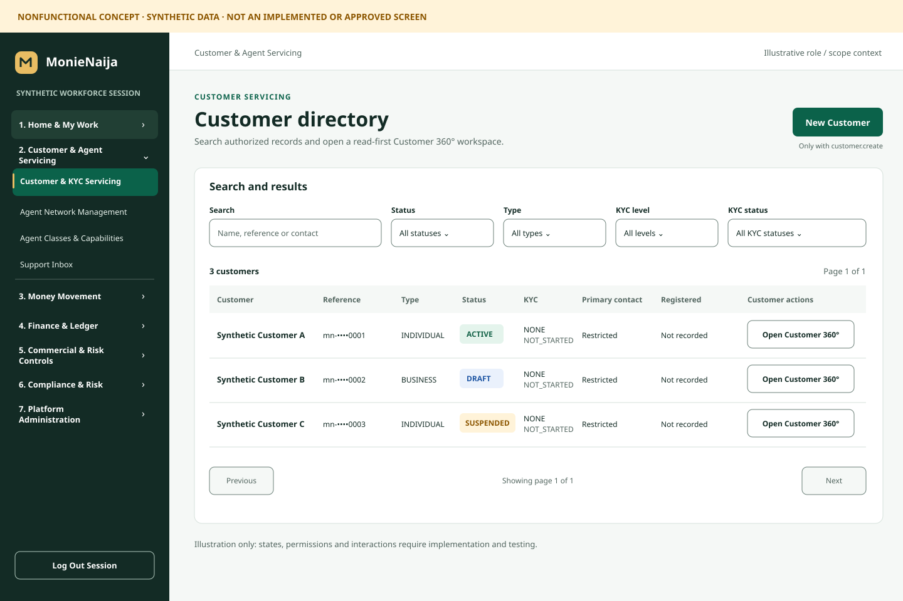
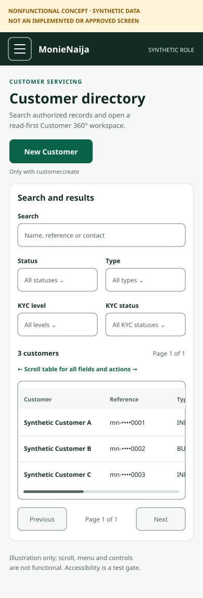

# Grounded Clarity — approval specification

**Proposed, not approved or implemented.** A calm, recognizably MonieNaija interface: deep treasury green, warm neutral surfaces, restrained gold, clear information hierarchy and explicit, truthful states. Prioritize legible amounts, names/authorized identifiers and status over decorative effects. Preserve all existing workflows, security controls and business semantics. This specification sharpens the [discovery design system](../03-design-system.md); it does not redefine platform capabilities.

## Visual concepts

These are **static, nonfunctional illustrations with entirely synthetic records**, not screenshots, working prototypes, approved branding, role fixtures or evidence that a capability exists. The small geometric brand mark is only a placeholder, not a proposal to replace the existing logo. The desktop sidebar depicts groups a user might have collapsed; it does not prescribe changing current initial expansion defaults. Conditional **New Customer**, Customer 360°, all seven navigation groups and existing filters/actions remain present when permitted. Data states and assistive behavior are specified below, not demonstrated by the images.

### Desktop: directory and seven-group shell

### Narrow web: stacked filters and locally scrollable table

The narrow image intentionally shows only the left portion of the two-dimensional table: an implemented version must make every column and action discoverable and reachable by touch, pointer, keyboard and assistive technology. It must not clip or silently remove actions. The images do not show every loading, restricted, empty, error, zoom or open-drawer state and are not evidence of accessibility conformance.

## Light-first semantic tokens

Use opaque sRGB values and explicit semantic names, not hard-coded status colors in individual screens. CSS names below are proposed identifiers; the token source should be local to the approved pilot. The gold accent is decorative unless paired with a verified foreground; do not use white text on gold.

| Semantic token / intended pairing | Value | Calculated ratio |
|---|---|---:|
| `surface.canvas` / `text.primary` | `#F5F8F6` / `#132B25` | 14.03:1 |
| `surface.raised` / `text.primary` | `#FFFFFF` / `#132B25` | 15.00:1 |
| `surface.raised` / `text.secondary` | `#FFFFFF` / `#52655F` | 6.20:1 |
| `action.primary` / `text.onAction` | `#0B624A` / `#FFFFFF` | 7.34:1 |
| `border.control` / raised surface | `#6D817A` / `#FFFFFF` | 4.14:1 |
| `focus.ring` / raised surface | `#0B624A` / `#FFFFFF` | 7.34:1 |
| `status.success` / soft background | `#146348` / `#E4F4EC` | 6.35:1 |
| `status.warning` / soft background | `#8C5600` / `#FFF3D9` | 5.54:1 |
| `status.danger` / soft background | `#B3261E` / `#FDEBE9` | 5.68:1 |
| `status.info` / soft background | `#2057A4` / `#EAF1FC` | 6.24:1 |
| `brand.accent` | `#E9BD63` decorative; `#8C5600` for tested text pairings | Pair-dependent |

Ratios are calculated from relative luminance for these exact opaque pairs, not guarantees for opacity, anti-aliasing, adjacent backgrounds, disabled states or images. Normal text targets at least 4.5:1, large text and meaningful non-text boundaries 3:1. Check every rendered use and interactive state, including the focus ring against its actual adjacent colors. Status also requires text/shape, never color alone. The full calculation and deferred dark token examples are in [discovery](../03-design-system.md#calculated-pair-checks).

**Theme strategy:** light is the only M1 release target. Dark mode is deferred, has no automatic switch in this proposal, and requires a separate owner decision and rendered component/device contrast review. No external font, icon service or new application dependency is implied.

## Typography, numbers and rhythm

- Use local system UI fonts (`system-ui`, `-apple-system`, sans-serif for web; native system fonts in later mobile work). Preserve user/browser text scaling. Avoid small uppercase text for essential information.
- Desktop page/balance heading ~32/40px, narrow ~28/36px; section 20/28px; control label 14/20px; body 14–16px web and 16/24 native; secondary text normally ≥12/18px. These are starting sizes, not limits on zoom or dynamic type.
- Set `font-variant-numeric: tabular-nums` for financial figures and dense tables when the font supports it. Show an authoritative amount with explicit currency, sign and appropriate decimals; preserve exact minor units and full accessible values. No unsafe rounding, inferred fee/total, invented timestamp or client-side policy calculation. Identifiers such as six-digit transfer numbers remain text, preserving leading zeros.
- A 4px scale: 4, 8, 12, 16, 24, 32, 40, 48, 64; typical 16px within controls and 24px between sections. Use 8px control, 12px card and 16px sheet radii. Cards use a restrained border or subtle shadow; dense tables need not be elevated. Motion 120–180ms only when useful; respect reduced-motion settings.

## Layout and responsive interaction

- **≥1024 CSS px:** persistent sidebar with all seven existing role-filtered groups, clear current page and a flexible, bounded main workspace. **600–1023:** collapsible navigation and 24px gutters; filters reflow as space allows. **320–599:** one column, 16px gutters, 44px preferred touch targets, stacked primary content and a modal navigation drawer. These are proposed design breakpoints; actual fit and 200%/400% zoom testing may require adjustments without altering behavior or obscuring content.
- Keep groups and their destinations, exact function-scope/role/context guards, navigation aliases, logout, and existing actions. A visual group may be collapsed but must remain discoverable. Do not assume a role alone grants compliance access. A named skip link and a usable main target should not create nested main landmarks; focus the destination heading or a suitable workspace target after a successful navigation.
- **Modal drawer contract:** toggle has an accessible name, `aria-expanded` and `aria-controls`; the open drawer is labeled as a dialog with a named navigation landmark. Opening moves focus inside; focus stays within while modal and background interaction/scroll is prevented. A clearly named close control, Escape and backdrop dismissal close it and return focus to the toggle. On successful destination selection, close it and move focus to the newly rendered page heading or stable workspace target; on denied navigation, retain the guard and do not imply a successful route change. Restore focus appropriately at breakpoint changes. No modal may hide an in-flight financial operation or imply it was cancelled.
- Use semantic table markup for the Directory with column and row context. At narrow sizes, a named, focusable local horizontal-scroll region may contain this inherently two-dimensional table; provide a visible scroll cue, keyboard scrolling, full contents and safe action labels. Prefer keeping identifying row context visible during horizontal scroll where it can be implemented without breaking table semantics; verify across target assistive technologies. Do not create page-wide overflow merely to fit forms. A labeled, equivalent detail presentation is an option only if all fields/actions and semantics are retained and owners approve it.
- Mobile-native layouts in later phases respect safe areas, keyboard avoidance and large text; current portrait-only configuration is not silently changed. No actual native redesign or device conformance is included in M0 or M1.

## Component and state contract

| Element | Required presentation and behavior |
|---|---|
| Button / link | Use semantic elements with a clear accessible name, visible focus, hover/pressed and disabled/loading states. Prefer ≥44×44 CSS px/pt (48dp Android); WCAG 2.2's 24×24 CSS px minimum and spacing exceptions still apply. Do not use opacity alone to explain unavailable actions. |
| Field / select | Persistent associated label, text instructions, error linkage and appropriate input semantics; complete values remain available. Do not change PIN, OTP, autofill or direct security-flow rules. |
| Status / feedback | Loading, empty, partial/stale, restricted, error, pending, unknown, definitive failure, replay and completed are distinct. Announce material changes appropriately and persist consequential errors; use the per-flow [owner matrix](02-owner-decisions.md#d13--outcome-vocabulary-and-safe-actions), never invent a status or expose a secret. |
| Directory data | Readable search and existing status/type/KYC filters; server-backed count/page; semantic column headers and row actions; masked reference and permission-dependent contact. A fetch error must not be presented as an authoritative zero or an empty successful result; existing request and retry behavior remain intact. |
| Focus / motion | Visible, non-obscured focus indicator with sufficient adjacent contrast; no unexpected focus loss, keyboard trap or required animation. Modal focus containment must include an explicit exit. Support `prefers-reduced-motion`. |
| Financial review / receipt, later only | Present authoritative amount/currency, exact recipient or authorized identifier, state and allowed next step. Unknown fees, identity and handover remain unknown; replay and ambiguous recovery are not new transfers. Preserve existing authorization, accounting and secret policies. |

## Approval and validation

Product/Design/Accessibility should approve or annotate the two concepts, token pairings, responsive breakpoints and drawer/table behavior. The [M1 acceptance](04-m1-scope.md#acceptance-criteria) requires automated checks plus real keyboard, zoom and desktop screen-reader testing; token calculations and M0 Chromium accessibility-tree inspection alone are not a WCAG certification. Security/authorization review must confirm parity, while independent Arena 4 acceptance remains separate. Any material change to policy, contracts, dark mode or excluded surfaces returns for separate approval.
